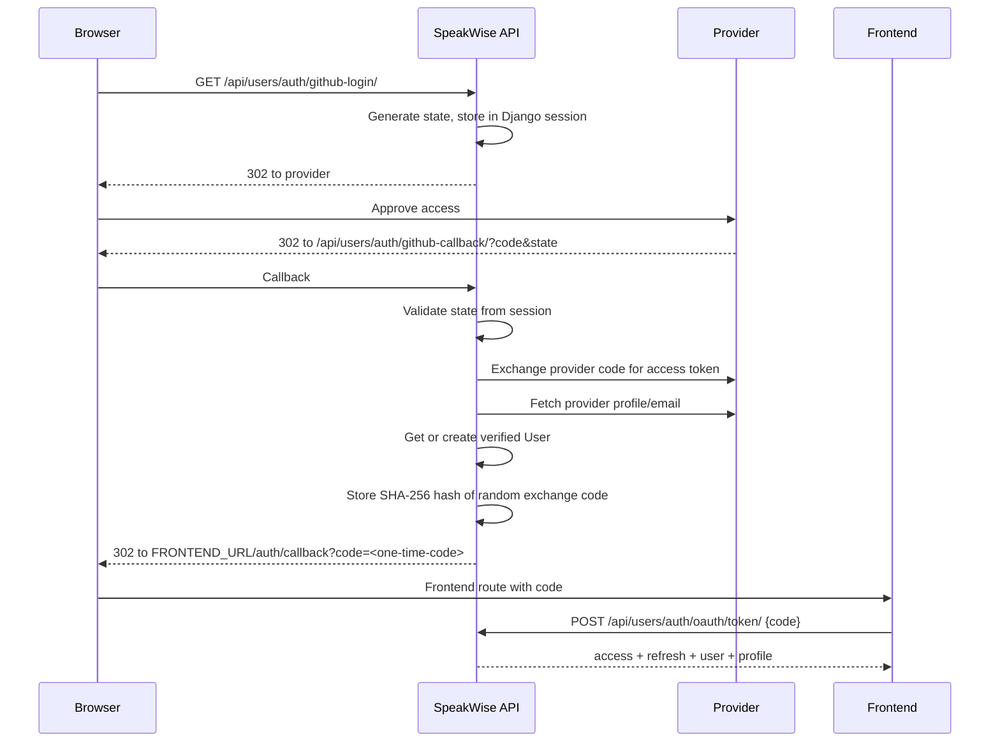

# Authentication

SpeakWise uses JSON Web Tokens (JWT) for API authentication. Clients obtain an
access token through email/password login, registration, or an OAuth exchange,
then send it on every protected request:

```http
Authorization: Bearer <access-token>
```

The project uses `djangorestframework-simplejwt`. The API does not authenticate
with Django sessions; the OAuth views use a session only to carry `state`
between the login redirect and the callback. (Django admin uses sessions
separately.)

## Token lifetime and limitations

| Token | Lifetime | Purpose |
|---|---|---|
| Access | 60 minutes | Authorizes API requests. |
| Refresh | 1 day | Can be blacklisted on logout. |

Important: **there is no token-refresh endpoint in the URL configuration.**
Although login returns a refresh token, the API does not expose a route that
exchanges it for a new access token. When the access token expires, the client
must authenticate again.

Access tokens are not checked against a server-side denylist on every request.
Logout blacklists the supplied refresh token, but an already-issued access token
remains usable until it expires. This is standard SimpleJWT behaviour, not a
per-endpoint policy.

The token payload includes the standard JWT claims plus a snapshot of the user's
serialized fields. This is convenient for clients but means the token can become
stale relative to the database (for example, after an email or nationality
change). Treat the `/api/users/me/` response as authoritative for profile data.

## Authentication summary

| Flow | Endpoints | Result |
|---|---|---|
| Email/password registration | `POST /api/users/auth/register/` | Creates an unverified user, sends an OTP, returns tokens and user data. |
| OTP verification | `POST /api/users/auth/verify-otp/` | Marks the email verified and sends the welcome email. |
| OTP resend | `POST /api/users/auth/resend-otp/` | Replaces the active OTP and sends a new one. |
| Login | `POST /api/users/auth/login/` | Returns tokens, user data, and an optional profile summary. |
| Logout | `POST /api/users/auth/logout/` | Blacklists a refresh token. |
| Password reset request | `POST /api/users/auth/password-reset/` | Emails a reset token link. |
| Password reset confirm | `POST /api/users/auth/password-reset/confirm` | Sets a new password. |
| GitHub OAuth | `GET /api/users/auth/github-login/` then callback | Redirects to the frontend with a one-time exchange code. |
| Google OAuth | `GET /api/users/auth/google-login/` then callback | Same flow as GitHub. |
| OAuth exchange | `POST /api/users/auth/oauth/token/` | Trades a short-lived code for tokens. |

## Registration

```http
POST /api/users/auth/register/
Content-Type: application/json
```

### Request

| Field | Type | Required | Notes |
|---|---|---|---|
| `email` | string | Yes | Unique, valid email. |
| `username` | string | Yes | Unique. |
| `password` | string | Yes | Validated with Django's password validators. |
| `first_name` | string | No | May be `null`. |
| `last_name` | string | No | May be `null`. |
| `nationality` | string | No | May be `null`. |
| `turnstile_token` | string | Conditional | Required when `TURNSTILE_SECRET_KEY` is configured; ignored/skipped otherwise. |

```json
{
  "email": "ada@example.com",
  "username": "ada",
  "password": "correct-horse-battery-staple",
  "first_name": "Ada",
  "last_name": "Lovelace",
  "nationality": "British"
}
```

If turnstile is configured, send the widget token as `turnstile_token` alongside
the other fields. The server verifies it with Cloudflare and forwards the
client IP when available; a missing or invalid token is rejected.

### Response `201 Created`

The response is the authentication payload used by registration and login:

```json
{
  "id": "e4b5d7d5-3c1a-4f4e-9f0f-6f7a8b9c0d1e",
  "first_name": "Ada",
  "last_name": "Lovelace",
  "email": "ada@example.com",
  "nationality": "British",
  "username": "ada",
  "is_email_verified": false,
  "refresh": "<refresh-token>",
  "access": "<access-token>"
}
```

Registration creates the account with `is_email_verified = false`. The user can
use the returned access token for endpoints that do not require verification,
but verified-only actions (creating speaker/organization profiles and requesting
a feedback QR code) will return `403`.

### Status codes

| Status | Condition |
|---|---|
| `201` | Account created. |
| `400` | Invalid fields, duplicate email/username, weak password, or failed Turnstile check. |
| `429` | Register throttle exceeded (5/hour). |

## OTP verification

```http
POST /api/users/auth/verify-otp/
Content-Type: application/json
```

The OTP is a six-digit numeric code generated with a cryptographically secure
random source. Only a salted PBKDF2 hash is stored. Rules:

- Valid for **10 minutes**.
- Maximum of **3 verification attempts**.
- A new code invalidates any previous unused code.
- Resend has a **2-minute cooldown**.
- Verification marks the code used and sets `is_email_verified = true`.
- A welcome email task is enqueued only after successful verification.

### Request

```json
{
  "email": "ada@example.com",
  "otp": "123456"
}
```

The field name is `otp`.

### Response `200 OK`

```json
{"detail": "Email verified successfully."}
```

### Errors

| Status | Condition |
|---|---|
| `400` | Unknown/unverified email, expired code, already-used code, incorrect code, or attempt limit reached. |
| `429` | Verification throttle (10/minute) exceeded. |

## Resend OTP

```http
POST /api/users/auth/resend-otp/
Content-Type: application/json
```

```json
{"email": "ada@example.com"}
```

A new code is issued only when the account exists, is not already verified, and
the two-minute cooldown has elapsed. The endpoint deliberately returns the same
success response in every case to avoid exposing account state:

```json
{"detail": "A new verification code has been sent."}
```

If the account is unknown, already verified, or still inside the cooldown, the
response is still `200 OK`, but no email is sent. The resend throttle is 5
requests/minute; exceeding the throttle returns `429`.

## Login

```http
POST /api/users/auth/login/
Content-Type: application/json
```

```json
{
  "email": "ada@example.com",
  "password": "correct-horse-battery-staple"
}
```

The login response extends the registration payload with a `profile` object:

```json
{
  "id": "e4b5d7d5-3c1a-4f4e-9f0f-6f7a8b9c0d1e",
  "first_name": "Ada",
  "last_name": "Lovelace",
  "email": "ada@example.com",
  "nationality": "British",
  "username": "ada",
  "is_email_verified": true,
  "refresh": "<refresh-token>",
  "access": "<access-token>",
  "profile": {
    "speaker_profile": {
      "id": "1b2c3d4e-5f60-4a7b-8c9d-0e1f2a3b4c5d",
      "slug": "ada-lovelace",
      "speaker_name": "Ada Lovelace",
      "username": "ada",
      "short_bio": "Mathematician and computing pioneer.",
      "country": "United Kingdom",
      "avatar": null,
      "social_links": [],
      "skill_tags": [],
      "followers_count": 0,
      "following_count": 0,
      "is_following": false
    }
  }
}
```

`profile` may be `{}` when the user has neither profile, or contain
`organization_profile` instead. A user cannot have both (see
[Models](../models.md#the-one-profile-rule)).

Login rejects unverified email/password accounts. OAuth accounts are created
verified and can log in through the OAuth exchange flow.

### Login lockout

Failed logins increment a per-email counter in the shared cache:

- Limit: **3 failures within 5 minutes**.
- The lockout applies to the email address, not the IP.
- The counter is keyed by lower-cased email and stored in the PostgreSQL cache,
  so it survives worker restarts.
- A successful login clears the counter.

While locked, login returns `400 Bad Request` with a lockout message. In local
development, clear the cache with:

```bash
uv run python manage.py shell -c "from django.core.cache import cache; cache.clear()"
```

### Status codes

| Status | Condition |
|---|---|
| `200` | Credentials valid and email verified. |
| `400` | Invalid credentials, unverified email, or lockout. |
| `429` | Login throttle (10/minute) exceeded. |

## Logout

```http
POST /api/users/auth/logout/
Authorization: Bearer <access-token>
Content-Type: application/json
```

```json
{"refresh": "<refresh-token>"}
```

The refresh token is passed to SimpleJWT's blacklist. The access token is not
revoked server-side; it remains valid until its 60-minute expiry.

### Response `205 Reset Content`

No body. An invalid, missing, or previously blacklisted refresh token returns
`400 Bad Request`.

## Password reset

### Request a reset

```http
POST /api/users/auth/password-reset/
Content-Type: application/json
```

```json
{"email": "ada@example.com"}
```

If the account exists, a reset token is generated with Django's
`PasswordResetTokenGenerator` and emailed as a frontend link containing the
email and token. The response is deliberately generic:

```json
{"detail": "Password reset email sent successfully."}
```

Throttle: 3 requests/hour. Multiple requests within the throttle window return
`429`.

### Confirm a reset

```http
POST /api/users/auth/password-reset/confirm
Content-Type: application/json
```

> **Trailing slash:** this route does **not** end with a slash. That is the
> current URL configuration.

```json
{
  "email": "ada@example.com",
  "token": "<token-from-email>",
  "new_password": "a-new-strong-password"
}
```

The token is validated with Django's password reset generator and the password
is checked by Django's password validators. On success:

```json
{"detail": "Password reset successfully."}
```

Invalid or expired tokens, unknown users, or weak passwords return
`400 Bad Request`.

## OAuth: GitHub and Google

OAuth is a browser redirect flow followed by a one-time code exchange. It avoids
putting JWTs in a redirect URL or browser history.

### End-to-end flow



### Start endpoints

| Provider | Start route | Callback route |
|---|---|---|
| GitHub | `GET /api/users/auth/github-login/` | `GET /api/users/auth/github-callback/` |
| Google | `GET /api/users/auth/google-login/` | `GET /api/users/auth/google-callback/` |

Both start routes return a `302` redirect to the provider. The OAuth `state` is
stored in the Django session, so the callback must reach the same session store.
If the state is missing or does not match, the callback returns
`400 Bad Request` with `{"error": "..."}`.

### Callback success

On success the callback redirects to:

```text
{FRONTEND_URL}/auth/callback?code=<one-time-code>
```

It never contains access or refresh tokens.

### Exchange the code

```http
POST /api/users/auth/oauth/token/
Content-Type: application/json
```

```json
{"code": "<one-time-code>"}
```

Exchange-code rules:

- Random, high-entropy code.
- Only its SHA-256 hash is stored.
- Single use.
- Expires after **120 seconds**.
- Unknown, used, or expired codes return `400 Bad Request`.
- Throttle: 10 requests/minute.

Success returns the same shape as login, including `refresh`, `access`, user
fields, and the optional `profile` object.

### Account behaviour

- If the provider email matches an existing user, that user is reused.
- Existing unverified accounts become verified after a successful provider
  login.
- New OAuth users are created with `is_email_verified = true` and a unique
  username derived from the provider display name or email local part.
- A provider response without an email is rejected.
- OAuth users still have no profile until they create one; the one-profile rule
  applies identically.

### Required configuration

Set the provider credentials and callback URLs in the environment:

```dotenv
GITHUB_CLIENT_ID=
GITHUB_CLIENT_SECRET=
GITHUB_REDIRECT_URI=http://localhost:8000/api/users/auth/github-callback/

GOOGLE_CLIENT_ID=
GOOGLE_CLIENT_SECRET=
GOOGLE_REDIRECT_URI=http://localhost:8000/api/users/auth/google-callback/
```

The redirect URI registered with the provider must match exactly.

## Forwarded client IP

Login lockout uses the email, but feedback cooldowns and Turnstile verification
need the client IP. `feedbacks.services.get_client_ip` and the auth/security
helpers honour common proxy headers (`X-Forwarded-For`, `X-Real-IP`) before
falling back to `REMOTE_ADDR`. Make sure the reverse proxy overwrites these
headers rather than passing client-supplied values through.

## Security checklist for client implementations

- Store refresh tokens in secure, server-side storage; never in `localStorage`
  if the frontend cannot protect against XSS.
- Send the access token in the `Authorization` header, not a query string.
- Treat the `profile` object in login responses as a convenience cache and
  refresh it from `/api/users/me/` when needed.
- Handle `401` by re-authenticating; there is no refresh route.
- Do not retry a failed OTP or login aggressively; respect the throttle and
  lockout windows.
- Complete OAuth on the same backend/session that started it, or the state check
  will fail behind multiple instances without shared sessions.
