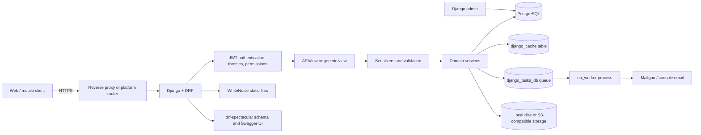
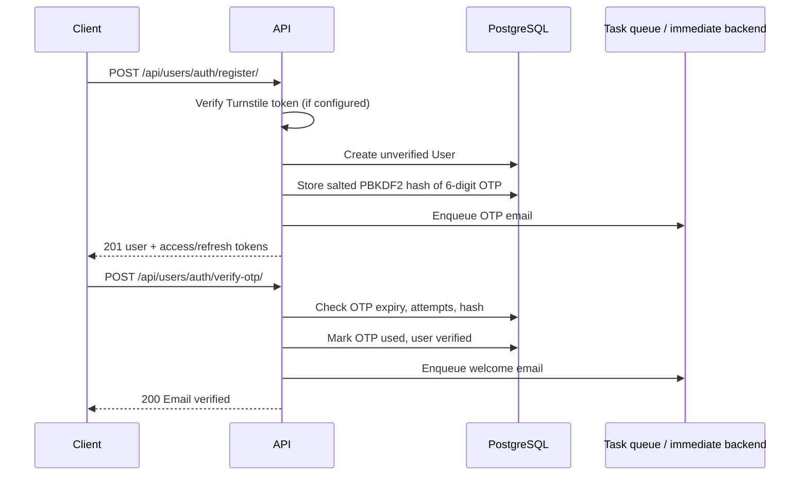
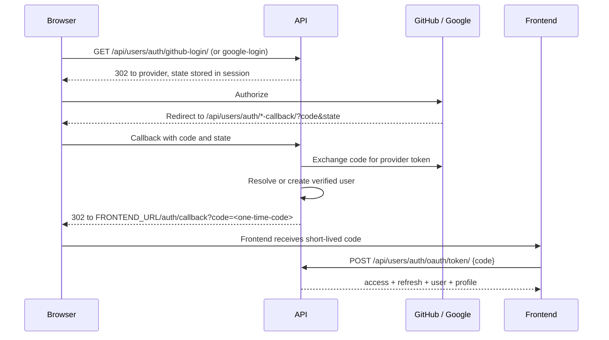

# Architecture

SpeakWise is a monolithic Django REST Framework application. A single Django
process serves a JSON API, the generated OpenAPI schema, the Django admin, and
static files. Domain responsibilities are split into Django apps, while shared
cross-cutting behaviour lives in `base`.

This document explains the moving parts and the reasons behind the main design
choices. For setup instructions, see [Installation](installation.md). For exact
permissions and endpoints, see [Permissions](api/permissions.md) and the
[Endpoint reference](api/endpoints.md).

## System context



The application has no separate service layer process, message broker, or
frontend build step. Redis is not required: both the cache and the background
task queue are stored in PostgreSQL.

## Django project layout

### Settings modules

| Module | Purpose | Database | Cache | Tasks |
|---|---|---|---|---|
| `speakwise.settings.base` | Shared configuration and defaults | Not defined | PostgreSQL `DatabaseCache` | Database queue |
| `speakwise.settings.local` | Local development | PostgreSQL via `DB_*` | PostgreSQL `DatabaseCache` (LocMem during tests) | Immediate |
| `speakwise.settings.production` | Deployed environments | `DATABASE_URL` or split `DB_*` | PostgreSQL `DatabaseCache` | Database queue |
| `speakwise.settings.test` | Automated tests | In-memory SQLite | LocMem | Immediate |

`manage.py` defaults to `speakwise.settings.local`. `wsgi.py` and `asgi.py`
default to `speakwise.settings.production` for deployed processes.

### Applications

| App | Responsibility | Key dependencies |
|---|---|---|
| `base` | Abstract timestamped model, shared social-link model, pagination helper, permission classes, file validators, JSON error handler, health check. | None |
| `users` | Custom `User`, JWT payload construction, OTP issuance/verification, OAuth login and exchange codes, password reset, user administration. | `profiles` serializers for login profile summaries |
| `profiles` | Speaker profiles, experiences, skills, social links, follows, notifications, organization profiles and CFPs. | `users`, `events`, `talks` (signals) |
| `events` | Event catalog, community submissions, admin approval, CFP windows, CFP Market. | `users` |
| `talks` | Talks, optional events, public visibility, review comments. | `profiles`, `events` |
| `feedbacks` | Public feedback by opaque experience slug, QR codes, aggregate summaries. | `profiles` |
| `speakerrequests` | Speaking invitations, response workflow, email-only requests. | `profiles`, `events`, `users` |
| `blogs` | Rich-text blog posts with publication status. | `users` |
| `teams` | Public team-member directory. | None |

Several imports are circular at the model level (`profiles` ↔ `events` ↔
`talks`). Django resolves these with string references such as
`"profiles.SpeakerProfile"`. Runtime imports that would create a cycle are
performed inside functions.

## Request lifecycle

A typical authenticated API request follows this path:

1. **Platform / reverse proxy** terminates TLS and forwards the request.
   Production settings trust `X-Forwarded-Proto` and set secure cookies.
2. **Middleware** adds security headers, serves static files through WhiteNoise,
   handles sessions (needed for OAuth `state`), applies CORS, enforces CSRF, and
   attaches the Django auth user.
3. **URL resolver** maps `/api/...` to an app URL module. Domain URL modules
   share the `/api/` prefix and expose named routes for `reverse()`.
4. **DRF view** selects authentication, throttles, and permissions. JWT is the
   only configured API authentication class.
5. **Serializer** validates input. Business rules that span models or have side
   effects live in service functions (for example `users/services/`,
   `feedbacks/services.py`, and `profiles/services/`).
6. **ORM** reads or writes PostgreSQL. Views use `select_related()` and
   `prefetch_related()` for data that will be serialized.
7. **Response renderer** returns JSON. General errors are normalised by
   `base.exception_handler.api_exception_handler`; the root URL configuration
   also supplies JSON 404/500 handlers.
8. **Side effects** such as welcome emails and organization status emails are
   enqueued through `django_tasks`. With the immediate backend they run inline;
   with the database backend a worker consumes them. Follower notifications are
   different: `profiles.signals` creates `Notification` rows synchronously via
   `transaction.on_commit`, not through the task queue.

### URL composition

`speakwise/urls.py` includes every app:

```text
/admin/                              Django admin
/api/schema/                         OpenAPI schema
/api/docs/                           Swagger UI
/api/docs/redoc/, /api/redoc/        ReDoc
/api/                                profiles (speakers + organizations)
/api/                                talks, users, teams, events, feedbacks,
                                     speakerrequests, blogs
/health/                             base health check
/ckeditor5/                          CKEditor upload endpoints
```

Each app declares an `app_name`, so routes are addressable with namespaces:
`users:login`, `events:event-list-create`, `speakers:speaker_follow`, and so on.

## Authentication architecture

The API is stateless from the client's perspective: clients send a JWT access
token in the `Authorization` header.

- `SimpleJWT` produces access tokens valid for **60 minutes** and refresh tokens
  valid for **1 day**.
- Registration, login, and OAuth exchange return the access token, refresh
  token, serialized user fields, and (for login-like flows) a `profile` object.
- Logout accepts a refresh token and blacklists it.
- There is **no refresh-token endpoint** in the URL configuration. A client
  whose access token expires must log in again (or the project must add a
  refresh route).
- The API uses a Django session only to persist the OAuth `state` value between
  the provider redirect and the callback. Sessions do not authenticate API
  requests because `SessionAuthentication` is not in
  `DEFAULT_AUTHENTICATION_CLASSES`; Django admin uses sessions separately.

See [Authentication](api/authentication.md) for the full flow.

## Core domain flows

### Registration and OTP verification



An OTP is a single-use six-digit code, valid for 10 minutes, with a two-minute
resend cooldown and a maximum of three verification attempts. Only a salted
PBKDF2 hash is stored. Issuing a new code invalidates any previous unused code.

Email/password users receive access tokens at registration but cannot perform
verified-only actions until OTP verification succeeds. Login itself rejects
unverified accounts.

### OAuth login



The callback never puts JWTs in a URL. It issues a hashed, single-use exchange
code valid for 120 seconds; the frontend trades it for tokens in a POST body.

### Event submission and approval

1. Any authenticated user can submit an event through `POST /api/events/`.
2. Non-superusers use `EventSubmitSerializer`; `is_active` is forced to `False`
   and `submitted_by` is set to the requester.
3. Superusers may create an event with the full `EventSerializer`, including
   `is_active`.
4. The public catalog lists only active events. Submitters can see their own
   pending events through `/api/events/me/` and `/api/events/<slug>/`.
5. A submitter or superuser can edit or delete the event. Non-superusers cannot
   reactivate it through the API; `is_active` is stripped from update payloads.
6. Events with a CFP deadline past the current time are closed automatically on
   save and by the `close_expired_cfps` task/command.

### Feedback via QR code

1. A verified speaker owns a `SpeakerExperiences` row with a generated
   `feedback_slug`.
2. `GET /api/feedbacks/qrcode/<slug>/` returns a PNG encoding
   `FRONTEND_URL/feedback/<slug>`; only the owning speaker can generate it.
3. The audience opens that frontend page, which reads
   `GET /api/feedbacks/rate/<slug>/` for presentation context.
4. `POST /api/feedbacks/rate/<slug>/` accepts six ratings from 1 to 10, an
   optional name, and optional comments.
5. Feedback opens at the linked event's start time when an event is attached;
   otherwise it opens on the experience's event date.
6. A salted hash of the client IP limits repeat submissions per presentation for
   60 minutes. The raw IP is never stored.
7. Speaker profile detail responses include a `feedback_summary` aggregate.

### Follows and notifications

`profiles.signals` listens for activity that followers should see:

- a new `SpeakerExperiences` row,
- a speaker being added to a public upcoming event
  (`SpeakerProfile.events_spoken`),
- an event becoming public,
- a talk becoming public.

The corresponding service creates one `Notification` per follower in bulk.
Notification links are relative frontend paths. Notifications are read through
`/api/notifications/` and marked read individually.

### Organization approval

Organization profiles are created in `pending` status by a verified user.
Signals enqueue:

- an admin alert when a pending organization is created
  (`ADMIN_NOTIFICATION_EMAILS`, skipped when the list is empty),
- an approval/rejection email when an admin changes `pending` to `active` or
  `rejected` in Django admin.

`old_status` is captured in a `pre_save` signal so the status transition can be
detected.

## Background work

The project uses `django_tasks` with `django_tasks_db.DatabaseBackend` in
production and the immediate backend locally and in tests.

| Task | Trigger | Purpose |
|---|---|---|
| `send_otp_email_task` | Registration, resend, email change | Deliver OTP code. |
| `send_welcome_email_task` | Successful OTP verification | Welcome email for manual signups. |
| `send_password_reset_email_task` | Password reset request | Deliver Django reset token link. |
| `send_organization_submitted_admin_email_task` | New pending organization | Alert admins. |
| `send_organization_status_email_task` | Admin approves/rejects | Notify organization. |
| `send_speaker_org_request_email` | Speaker request creation | Notify speaker. |
| `send_speaker_email_request_email` | Email request creation | Notify recipient. |
| `send_request_accepted_email`, `send_request_declined_email` | Speaker responds | Notify organizer. |
| `close_expired_cfp_events_task` | Manual/scheduled | Close expired CFPs. |
| `purge_expired_auth_tokens_task` | Manual/scheduled | Delete used/expired OTP and OAuth codes. |

**Operational consequence:** the database backend only records jobs. A
`db_worker` process must be running for queued email tasks (and the maintenance
tasks when invoked through the queue) to execute. In-app follower notifications
are created synchronously and do not depend on the worker. The base Compose file
defines a worker; the DigitalOcean App Platform and Railway manifests in this
repository define only a web service.

The two maintenance tasks also have management commands
(`close_expired_cfps`, `cleanup_auth_tokens`) and there is no scheduler in the
repository. Schedule them with the platform's cron mechanism or an external
scheduler.

## Caching and throttling

The default cache is Django's PostgreSQL `DatabaseCache` located at the
`django_cache` table. This makes throttle counters and login lockout state
consistent across Gunicorn workers without Redis.

Consequences:

- `createcachetable` must run on every fresh environment.
- Cache reads and writes hit PostgreSQL, adding some database load.
- Tests override the cache with `LocMemCache`; test classes that assert throttles
  clear the cache in `setUp()` to avoid cross-test leakage.

## File storage and uploads

- Local development writes uploads under `MEDIA_ROOT`
  (`speakwise/media` by default through `BASE_DIR/media`).
- Production uses local disk by default, or S3-compatible storage when a bucket
  variable is present. Both `AWS_*` and `R2_*` names are accepted; R2 names take
  precedence.
- Static files are collected at image build time and served by WhiteNoise with
  a compressed manifest storage backend.
- Uploads pass through shared validators: images must be JPG/JPEG/PNG/WebP and
  at most 5 MB; presentation files must be PDF/PPT/PPTX/JPG/JPEG/PNG/WebP and at
  most 20 MB. Django limits non-file request data to 10 MB, spills larger file
  parts to temporary storage, and rejects requests with more than 1000 fields.
  Reverse-proxy/platform body limits still apply to uploads.

## API documentation

`drf-spectacular` generates an OpenAPI 3 schema from views and serializers.
Swagger UI and ReDoc are public. Many views use `@extend_schema` to declare
request/response shapes and tags; coverage is uneven, so the hand-written
[Endpoint reference](api/endpoints.md) is the authoritative behavioural guide.

## Key design decisions and trade-offs

| Decision | Why | Trade-off |
|---|---|---|
| JWT instead of session auth for the API | Works cleanly for a separate frontend and mobile clients. | No server-side revocation of access tokens; no refresh route exists. |
| Email as the login identifier | Users are sourced by email across events and providers. | A custom manager and serializer validation are required. |
| One profile per user | Keeps the speaker/organizer identity unambiguous. | A user cannot be both a speaker and an organization owner. |
| UUID public identifiers | Avoids exposing sequential IDs and supports cross-system references. | Slightly larger keys and more verbose URLs. Most models use UUIDs; `OrganizationCFP` is the exception. |
| PostgreSQL-backed cache | Avoids running Redis. | Extra database traffic and a required cache table. |
| DB-backed background tasks | Avoids running a broker. | Requires a worker and has lower throughput than a dedicated queue. |
| Opaque feedback slugs | Audience feedback URLs contain no user or experience IDs. | Slug resolution is an extra lookup. |
| Pending approval for events and organizations | Prevents untrusted content from appearing publicly. | Requires admin operations and creates two status concepts. |
| Generated OpenAPI plus manual docs | Machine-readable schema for tooling; human context for behaviour. | The two can drift if not reviewed together. |

## Known architectural constraints

These are documented so new work does not assume capabilities that do not
exist:

- There is no organization membership model. Organization ownership is a single
  `owner` foreign key; speaker requests are not scoped to an organization.
- There is no role/permission system beyond Django's `is_staff`, `is_superuser`,
  and the email-verification flag.
- There is no refresh-token exchange endpoint.
- There is no API for managing `OrganizationCFP` records or `TalkSession`
  records; they are available in Django admin or through direct ORM work.
- Speaker request lists are not filtered by the requesting organizer.
- The repository contains multiple, partially overlapping deployment paths.
  See [Deployment](deployment.md) before changing production configuration.
