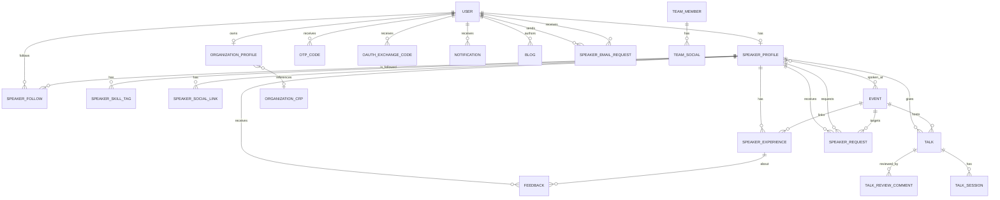

# Data Models

SpeakWise is a Django application; the models in each app are the source of
truth for the database schema. This page summarises the persisted entities,
their important constraints, generated fields, and deletion behaviour. Always
check `migrations/` alongside the model when changing a schema.

## Conventions

- **Base class:** shared timestamp fields come from
  `base.models.TimeStampedModel` (`created_at`, `updated_at`). Social links
  share `base.models.SocialLinks` (`name`, `link`).
- **Primary keys:** most resources use UUID primary keys generated in Python.
  `OrganizationCFP` uses Django's implicit `BigAutoField` because it has no
  explicit `id`; it has no standalone API.
- **Naming:** most tables use Django's default `<app>_<model>` name. Explicit
  table names are `feedbacks`, `team_member`, and `team_social`.
- **Time zones:** timestamps are stored in UTC and serialized as ISO 8601.
- **Text conventions:** the project uses nullable strings in several places
  (`null=True`), which differs from `AGENTS.md`. Do not "clean this up" without
  a migration and product agreement.
- **Generated values:** slugs, feedback tokens, and Talk slugs are generated in
  `save()` only when empty, so they remain stable after creation.
- **Implicit vs explicit rules:** one-speaker/one-organization is partly a
  database constraint (`OneToOneField`) and partly serializer validation; the
  cross-type "never both" rule is not a database constraint.

## Entity relationships

## Users and authentication

### `users.User`

Extends `AbstractUser`; `email` is the login field (`USERNAME_FIELD = "email"`).

| Field | Type | Notes |
|---|---|---|
| `id` | UUID | Primary key, indexed. |
| `first_name` | char(255), null | Optional. |
| `last_name` | char(255), null | Optional. |
| `username` | char(150), unique, indexed | Required and unique. |
| `email` | email, unique, indexed | Required, unique, used to log in. |
| `nationality` | char(255), null | Free text. |
| `is_email_verified` | boolean | Default `false`; OTP/OAuth sets it. |
| `welcome_email_pending` | boolean | Internal flag, not editable/serialized. |
| inherited | — | `password` hash, `is_active`, `is_staff`, `is_superuser`, `date_joined`, `last_login`, groups and permissions. |

`UserManager` supports creating users and superusers by email. Deleting a user
cascades to the speaker profile, organization profile, OTP/exchange codes,
notifications, and follows. Event, blog, and email-request `SET_NULL`
references survive, so email-request rows remain without their users.

### `users.OtpCode`

| Field | Type | Notes |
|---|---|---|
| `id` | UUID | Primary key. |
| `user` | FK → User | Cascades on delete; related name `otp_codes`. |
| `code_hash` | char(64) | PBKDF2-HMAC-SHA256 hash; plaintext is never stored. |
| `salt` | char(32) | Per-code salt. |
| `created_at` | datetime | Set on creation. |
| `expires_at` | datetime | Set from `OTP_EXPIRY_MINUTES`. |
| `is_used` | boolean | Single use. |
| `attempt_count` | positive int | Compared with `OTP_MAX_ATTEMPTS`. |

Properties `is_expired` and `is_locked` read the expiry and attempt threshold.
Issuing a new OTP marks earlier unused codes used.

### `users.OAuthExchangeCode`

| Field | Type | Notes |
|---|---|---|
| `id` | UUID | Primary key. |
| `user` | FK → User | Cascades on delete. |
| `code_hash` | char(64), unique, indexed | SHA-256 of the random exchange code. |
| `created_at` | datetime | Set on creation. |
| `expires_at` | datetime | 120 seconds after creation. |
| `is_used` | boolean | Single use. |

The plaintext code is returned only in the OAuth redirect and is never stored.

## Speaker profiles

### `profiles.SpeakerProfile`

| Field | Type | Notes |
|---|---|---|
| `id` | UUID | Primary key. |
| `user_account` | OneToOne → User | Required; cascades; related name `speakers_profile_user`. Enforces at most one speaker profile per user. |
| `events_spoken` | M2M → Event | Optional; related name `speakers`. |
| `organization` | char(255) | Free-text current organization (not a FK). |
| `short_bio` | char(255) | Optional. |
| `long_bio` | text, null | Optional. |
| `country` | char(255) | Optional. |
| `avatar` | image | Uploads to `speakers/avatars/`; JPG/JPEG/PNG/WebP, max 5 MB. |
| `slug` | slug, unique | Generated once from name → username → user ID, with numeric suffix on collision. |

`followers_count` is a property counting `SpeakerFollow` rows. `skill_tag` is a
compatibility alias for the `skill_tags` reverse FK manager.

### `profiles.SpeakerSocialLinks`

Extends the abstract `SocialLinks` model: `id`, `name` (nullable), `link`
(nullable URL), and `speaker` FK (cascades, related name `social_links`).
`unique_together = ("speaker", "name")`. The API syncs links by name.

### `profiles.SpeakerSkillTag`

| Field | Type | Notes |
|---|---|---|
| `id` | UUID | Primary key. |
| `name` | char(255), null | Nullable; the serializer does not require it and accepts `{}`. Validate it in the client if a name is required by the product. |
| `description` | text, null | Optional. |
| `duration` | positive int, null | Years of experience. |
| `speaker` | FK → SpeakerProfile, null | Cascades; related name `skill_tags`. |

The custom manager exposes `matching_skill_names(names)`: it normalizes names
(trim, lowercase, deduplicate), matches case-insensitively, and returns no rows
for an empty list. This helper is not currently exposed by an API filter.

### `profiles.SpeakerExperiences`

| Field | Type | Notes |
|---|---|---|
| `id` | UUID | Primary key. |
| `event_name` | char(255), null | Name of the event. |
| `event_date` | date | Required. |
| `topic` | char(255), null | Talk topic. |
| `description` | text, null | Optional. |
| `presentation_link` | URL, null | Slides. |
| `video_recording_link` | URL, null | Recording. |
| `speaker` | FK → SpeakerProfile, null | Cascades; related name `experiences`. |
| `event` | FK → Event, null | `SET_NULL`; optional platform event used for feedback date gating. |
| `feedback_slug` | slug(16), unique, blank | Opaque public feedback token; generated on first save. |
| `feedback_enabled` | boolean | Default `true`; speaker can opt out. |

Feedback opens at the linked event's start when present, otherwise at
`event_date`; see [Feedback](#feedback).

### `profiles.SpeakerFollow`

`id`, `follower` FK → User (related `following_speakers`), and `speaker` FK →
SpeakerProfile (related `followers`). Both cascade. `unique_together =
("follower", "speaker")`, so duplicate follows are impossible at the database
level. The API also rejects self-follows.

### `profiles.Notification`

`id`, nullable `user` FK (cascades, related `notifications`), `message` text,
`link` char(500), and `is_read` boolean indexed. Default ordering is newest
first. The FK is nullable, but deleting a user cascades and removes their
notifications; a null recipient therefore exists only if a row was created or
edited that way explicitly.

## Organizations

### `profiles.OrganizationProfile`

| Field | Type | Notes |
|---|---|---|
| `id` | UUID | Primary key. |
| `owner` | OneToOne → User, null | Cascades; related name `organization_owner`. At most one organization per user. |
| `name` | char(255), unique | Required. |
| `description` | text, null | Optional. |
| `website` | URL, null | Optional. |
| `branding` | image, null | Uploads to `organization_branding/`; image constraints. |
| `contact_email` | email, null | Optional. |
| `cfps` | FK → OrganizationCFP, null | `SET_NULL`; singular relation, related name `organization_cfp`. |
| `status` | char(50), null | `active`, `inactive`, `rejected`, `pending`; default `pending`. |
| `old_status` | char(50), null | Internal previous status; defaults `pending`. |
| `admin_notes` | text, null | Internal notes; currently exposed by the public serializer. |

There is **no organization membership table**. `owner` is the only user
association. `get_open_cfps()` and `get_closed_cfps()` query `OrganizationCFP`
rows by the reverse relation and current time.

### `profiles.OrganizationCFP`

| Field | Type | Notes |
|---|---|---|
| `id` | BigAutoField | Implicit integer primary key. |
| `url` | URL, null | CFP page. |
| `description` | text, null | Optional. |
| `open_at` | datetime, null | Optional opening time. |
| `close_at` | datetime, null | Optional closing time. |

CFPs are nested read-only data in the organization API; there is no standalone
CFP endpoint. An organization profile references at most one CFP, while the FK
technically permits several profiles to point at the same CFP.

## Events

### `events.Event`

| Field | Type | Notes |
|---|---|---|
| `id` | UUID | Primary key. |
| `title` | char(255), unique | Required. Unique globally, not just per website. |
| `event_nickname` | char(255) | Optional, default empty. |
| `event_image` | image, null | Uploads to `event_images/`; image constraints. |
| `description` | text | Optional, default empty. |
| `website` | URL(255) | Required; official site or public page. |
| `submitted_by` | FK → User, null | `SET_NULL`; related name `submitted_events`. |
| `start_date_time` | datetime, null | Defaults to now at creation. |
| `end_date_time` | datetime, null | Defaults to now at creation. |
| `is_active` | boolean, indexed | Default `false`; only superusers/API approval set it. |
| `slug` | slug(255), null, indexed | Generated from title on first save. **Not unique.** |
| `location` | char(150), null | Free-text venue/location. |
| `country` | char(100), null, indexed | Optional. |
| `is_free` | boolean, null | `null` means unspecified; required on API create. |
| `cfp_open` | boolean | Manual CFP flag, default `false`. |
| `cfp_link` | URL(255) | Default empty. |
| `cfp_open_date` | datetime, null | Optional window start. |
| `cfp_deadline` | datetime, null | Optional window end. |
| `cfp_speaker_notification_date` | date, null | Optional. |

Manager/queryset helpers:

- `find_duplicate(title, website, exclude_id)` — title case-insensitive plus
  normalized website. The serializer uses it, but `title` being unique already
  prevents most duplicates.
- `with_open_cfp()` — active and `cfp_open`, within optional open/deadline
  window.
- `with_expired_cfp()` — still marked open but past `cfp_deadline`.

`save()` generates a slug if empty and automatically sets `cfp_open=False` when
the deadline has passed. Slug collisions are not resolved, so two different
titles that slugify identically can share a slug. Detail routes resolve by slug,
which makes such collisions ambiguous.

## Talks

### `talks.Talks`

| Field | Type | Notes |
|---|---|---|
| `id` | UUID | Primary key. |
| `title` | char(255) | Required. |
| `description` | text | Required. |
| `speaker` | FK → SpeakerProfile | Cascades; related name `speaker_talks`. |
| `duration` | int | Minutes; required by the model. |
| `category` | char(100) | Choice from `TalkCategoryChoices`; see [Talk categories](#talk-categories). |
| `presentation_files` | file, null | Uploads to `presentation_files`; PDF/PPT/PPTX/images, max 20 MB. |
| `slug` | slug(255), unique, null | Generated on first save as `<title-slug>-<12 random chars>`. |
| `is_public` | boolean, indexed | Default `false`. |
| `is_reviewable` | boolean | Default `true`. |
| `event` | FK → Event, null | Cascades; related name `talk_event`. |

`TalkSession` is a child model (`talk` FK, `session_type`, `duration`) with no
API route. `TalkSerializer` declares a nested `session` field, but `Talks` has
no `session` attribute. On reads DRF skips the missing optional field, so talk
responses omit it; on writes the field is not supported by the create path.
Treat talk sessions as database/admin-only.

### `talks.TalkReviewComment`

`id`, nullable `talk` FK (cascades, related `talk_review_comments`), `rating`
integer validated 1–5, and required `comment` text. The model has no uniqueness
constraint, so the same talk can receive many reviews from the same or
anonymous clients.

## Feedback

### `feedbacks.Feedback`

Table name `feedbacks`.

| Field | Type | Notes |
|---|---|---|
| `id` | UUID | Primary key. |
| `speaker` | FK → SpeakerProfile, null | `SET_NULL`; related name `speaker_feedback`. |
| `experience` | FK → SpeakerExperiences, null | `SET_NULL`; related name `feedback`. |
| `overall_rating`, `engagement`, `clarity`, `content_depth`, `speaker_knowledge`, `practical_relevance` | int | Each required and validated 1–10. |
| `comments` | text(2000), null | Optional. |
| `name` | char(100) | Optional public name, default empty. |
| `is_anonymous` | boolean | Derived in `save()`: `not bool(name.strip())`. |
| `submitter_ip_hash` | char(64) | Salted hash of client IP for cooldown; never the raw IP. |

Default ordering is newest first. The speaker and experience are resolved from
the public feedback slug at submission time. `is_anonymous` is not client
controlled in normal API use even though it is a model field.

## Speaker requests

### `speakerrequests.SpeakerRequest`

| Field | Type | Notes |
|---|---|---|
| `id` | UUID | Primary key. |
| `speaker` | FK → SpeakerProfile, null | Cascades; related name `requests_received`. |
| `event` | FK → Event | Cascades. |
| `status` | char(20), indexed | `pending`, `accepted`, `declined`, `is_expired`, `cancelled`; default `pending`. |
| `message` | text | Required. |
| `accommodation_covered` | boolean | Default `false`. |
| `notes` | text, null | Internal organizer notes. |
| `proposed_duration` | positive int, null | Minutes. |
| `proposed_session_type` | char(50) | `online` or `in_person`; default `in_person`. |
| `proposed_topic` | char(255), null | Optional. |
| `requested_by` | FK → SpeakerProfile, null | Cascades; related name `requests_made`. |
| `responded_at` | datetime, null | Intended response timestamp; the current response endpoint does not populate it. |
| `response_deadline` | datetime, null | Optional. |
| `response_message` | text, null | Speaker's reply. |
| `speaker_fee` | decimal(10,2), null | Honorarium. |
| `travel_covered` | boolean | Default `false`. |

`unique_together = ("speaker", "event")` prevents duplicate invitations for the
same pair at the database level (for non-null speakers; PostgreSQL uniqueness
does not constrain NULLs). Default ordering is newest first. The custom
manager exposes `for_speaker(user)` (target speaker) and `for_organizer(user)`,
but **`for_organizer` always returns an empty queryset** because organization
membership does not exist. The API list view currently bypasses both helpers and
returns all rows.

The response workflow does not validate every status transition, and accepting or
declining currently reads `event.location.venue` even though `location` is a
string. See the [permissions gaps](api/permissions.md#current-access-control-gaps).

### `speakerrequests.SpeakerEmailRequests`

| Field | Type | Notes |
|---|---|---|
| `id` | UUID | Primary key. |
| `event` | char(255) | Event name as free text, not a FK. |
| `location` | char(255) | Free text. |
| `request_from` | FK → User, null | `SET_NULL`; related name `speaker_requests`. |
| `request_to` | FK → User, null | `SET_NULL`; related name `speaker_requests_received`. |
| `message` | text | Required. |
| `status` | char(225) | Same choices as `SpeakerRequest`; default `pending`. |

Despite the API parameter being called `speaker_id`, `request_to` is a `User`,
not a `SpeakerProfile`. There is no unique constraint on the pair, so repeated
requests are allowed.

## Blogs and teams

### `blogs.Blog`

| Field | Type | Notes |
|---|---|---|
| `id` | UUID | Primary key. |
| `image` | image, null | Uploads to `blog_images/`; image constraints. |
| `title` | char(255) | Required. |
| `short_description` | char(255) | Optional, default empty. |
| `full_description` | CKEditor5 text | Optional HTML-rich content. |
| `created_by` | FK → User, null | `SET_NULL`; related name `blogs`. |
| `published_date` | date, null | Optional. |
| `status` | char(20) | `draft` (default), `published`, `archived`. |

Default ordering is `-published_date`, then `-created_at`.
`unique_together = (("created_by", "title"),)`, so the same author cannot reuse a
title; different authors can. Because `created_by` is nullable, NULL-author rows
are not constrained against each other by PostgreSQL's default uniqueness
semantics.

### `teams.TeamMember`

Table name `team_member`.

| Field | Type | Notes |
|---|---|---|
| `id` | UUID | Primary key. |
| `name` | char(100) | Required. |
| `role` | char(100) | Required. |
| `short_bio` | text(500) | Required. |
| `avatar` | image, null | Uploads to `team/avatars/`; image constraints. |
| `is_active` | boolean | Default true; API lists active members only. |
| `display_order` | int | Default 0; ordering is `display_order`, then `name`. |

`avatar_url` returns the relative media URL (or `None`); the serializer also
builds an absolute `avatar_url` when request context is available.

### `teams.TeamSocial`

Table name `team_social`; extends `SocialLinks` with a UUID id and a
`team_member` FK (cascades, related name `social_links`). `name` and `link` are
nullable.

## Cross-model rules

### The one-profile rule

A user may have **either** one `SpeakerProfile` **or** one
`OrganizationProfile`, never both and never more than one of either. The
database enforces "at most one of each" through `OneToOneField`. The cross-type
rule is enforced in serializer create logic:

- Speaker creation rejects a user who already has an organization profile.
- Organization creation rejects a user who already has a speaker profile or an
  organization profile.
- Both creation paths require an authenticated (and, at the view, verified)
  user.

There is no database constraint preventing two concurrent create requests from
racing. Both serializers also set the owner/account from the request, so a
client cannot assign a profile to another user.

### Event visibility and CFP state

- `is_active=False` is the default and the required state for ordinary community
  submissions; API approval/superuser action activates an event.
- `Event.save()` closes a CFP whose deadline has passed, even if
  `cfp_open=True` was submitted.
- `is_cfp_currently_open` additionally requires the event to be within the
  optional open/deadline window.
- `with_open_cfp()` is the canonical CFP Market queryset.

### Generated tokens and slugs

| Value | Generated when | Stability |
|---|---|---|
| `SpeakerProfile.slug` | First save, from name/username/ID | Stable; unique with numeric suffix. |
| `SpeakerExperiences.feedback_slug` | First save, `secrets.token_urlsafe(6)` | Stable, unique, max 16; used in QR/feedback URLs. |
| `Talks.slug` | First save, title plus 12 random characters | Stable, unique. |
| `Event.slug` | First save, `slugify(title)` | Stable, but **not unique**. |

Do not regenerate these tokens on every save; old QR codes, links, and reviews
depend on them remaining stable.

### Deletion behaviour

| Delete | Cascades / nullifies |
|---|---|
| `User` | Deletes speaker profile, organization profile, OTP codes, OAuth codes, follows, and notifications. `Event.submitted_by`, `Blog.created_by`, and `SpeakerEmailRequests.request_from/request_to` become NULL; the email-request rows survive. |
| `SpeakerProfile` | Deletes social links, skills, experiences, follows, talks, sent/received speaker requests. `Feedback.speaker` becomes NULL; feedback rows that reference a deleted experience also lose that link. |
| `Event` | Deletes talks and speaker requests; `SpeakerExperiences.event` becomes NULL; the M2M `events_spoken` rows are removed. |
| `SpeakerExperiences` | Deletes nothing else; `Feedback.experience` becomes NULL. |
| `OrganizationProfile` | Leaves the referenced `OrganizationCFP` row in place (`SET_NULL` on the profile side). |
| `OrganizationCFP` | Clears `OrganizationProfile.cfps` for referencing profiles. |

## Talk categories

`TalkCategoryChoices` values are lowercase strings:

`ai and ml`, `cloud and devops`, `cybersecurity`, `data science`, `frontend`,
`backend`, `fullstack`, `mobile`, `web`, `devtools`, `programming languages`,
`software architecture`, `database`, `blockchain`, `iot`, `quantum computing`,
`open source`, `agile`, `emerging technologies`, `tech ethics`.

## Model-level gotchas

1. **`Event.title` is unique while duplicate detection also compares website.**
   A second event with the same title is rejected even with a different site.
2. **`Event.slug` is not unique and has no collision suffix.** Two titles that
   slugify the same produce ambiguous detail routes; slug lookups then raise
   `MultipleObjectsReturned` and return `500`.
3. **`OrganizationCFP` is effectively admin-only.** The API exposes it nested,
   read-only, and never accepts it on create/update.
4. **`SpeakerEmailRequests` uses strings, not relations, for event/location.**
   It is intentionally separate from `SpeakerRequest`.
5. **`SpeakerSkillTag.name` is nullable and optional in the serializer.** An
   empty `POST {}` succeeds and creates a null-named row; product validation
   must enforce a name if required.
6. **`Feedback` keeps rows after speaker/experience deletion** via `SET_NULL`;
   `speaker` and `experience` can both be null in old data.
7. **`Blog` has no ownership constraint in the API.** The model records
   `created_by`, but views do not enforce it for updates/deletes, and the
   serializer exposes `created_by` as writable on `PATCH`.
8. **`TalkSession` is dormant.** Rows can exist in the database/admin but no API
   route reads or writes them. The serializer's optional `session` field is
   skipped on reads because the parent model lacks the attribute.
9. **Model docstrings can lag behind implementation.** For example, `OtpCode`'s
   docstring says SHA-256 while the service actually uses salted PBKDF2; trust
   the service and this page for algorithm details.

